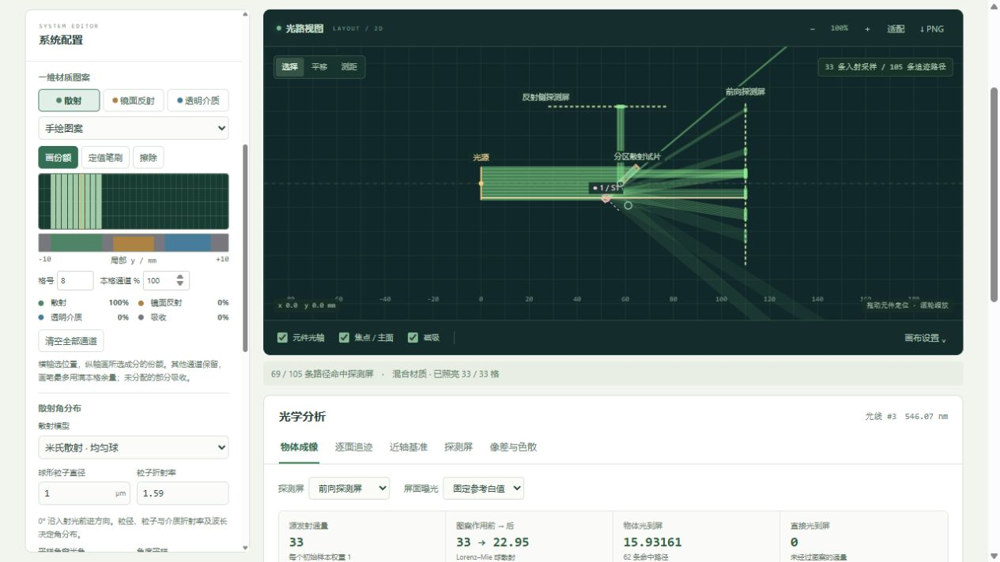
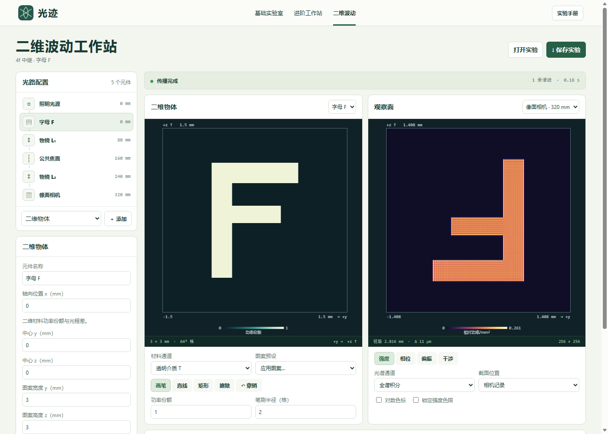

# LightTrace 光迹

光迹是一款可离线运行的浏览器光学实验台。基础实验室演示物距、焦距与成像。进阶工作站沿真实曲面追踪折射、反射、散射和截光。二维波动工作站沿用光源与光路，支持绘制二维物体、查看相机上的强度、光谱、偏振与相位，并用四张干涉强度图测量相对相位。



## 开始使用

**离线打开。** 从 GitHub 页面选择 **Code → Download ZIP**，解压整个文件夹，在浏览器中打开 `index.html`。打开 `wave.html` 可直接进入二维波动工作站。在进阶页点「二维波动 ↗」能把当前配置带入新页。三个实验台右上角的「实验手册」均可打开完整教程。

**本地服务器。** 安装 Git 和 Node.js（含 npm）后，可从终端运行以下命令。已有项目副本时，在项目目录执行最后一行即可。

```sh
git clone https://github.com/CSSAcslin/LightTrace.git
cd LightTrace
npm start
```

在浏览器中打开 [基础实验室](http://127.0.0.1:4173/)、[进阶工作站](http://127.0.0.1:4173/advanced.html)、[二维波动工作站](http://127.0.0.1:4173/wave.html) 或 [独立实验手册](http://127.0.0.1:4173/manual.html)。本地服务支持后台计算，终端按 `Ctrl+C` 可停止。

## 选择实验台

| 想研究的问题 | 入口与操作 | 可以读到的结果 |
| --- | --- | --- |
| 物体靠近透镜时，像怎样移动？ | **基础实验室**。拖动物体，改变焦距或通光口径，将观察屏移到实像面。 | 像距、放大率、实像与虚像、离焦量、尖端光束半径。 |
| 两片镜能否把物体等大倒像？ | **基础实验室**。选「双透镜 · 4f 中继系统」，逐片查看成像。 | 光线矩阵、每一级的像坐标与累计放大率。 |
| 厚度、曲面与材料如何影响聚焦？ | **进阶工作站**。选中厚透镜，用曲率半径或前、后表面各自的像方焦距设定镜形。 | 编辑区显示单片有效焦距（EFL）和后焦截距（BFL）。在「光学分析 → 近轴基准」选波长，可并排核对各镜片参数。 |
| 光经过多个器件后去了哪里？ | **进阶工作站**。组合透镜、光阑、平面镜、透射光栅和探测屏，调整位置与倾角。 | 每次折转或截光的位置、不同波长的落点，以及各屏接收的相对通量。 |
| 为什么两片偏振片会消光？波片怎样产生圆偏振？ | **进阶工作站**。选择双偏振片或四分之一波片预设，调整透光轴、快轴角和光源波长。 | 光段偏振符号、逐面偏振变换，以及探测屏的相对功率、归一化 Stokes 向量与偏振度。 |
| 物体图案怎样影响屏上的明暗？ | **进阶工作站**。在「物体与图案」中绘制材质，调整散射模型、粒径、角窗或曝光。 | 33 格物面份额、逐分支光路、一维屏面能量分布与系统能量收支。 |
| 一幅二维图案经过 4f 光路会怎样？ | **二维波动工作站**。在物面画字母或双缝，依次选择物面、公共焦面和像面相机。 | 二维强度与相位、Stokes 图、偏振椭圆、单点与区域光谱、带物理刻度的线剖面。 |
| 怎样测出透明物体的相位台阶？ | **二维波动工作站**。以单色线偏振光照明透明台阶，在物体出射面进入「干涉」。 | 四帧强度、相对参考光的重建相位与条纹可见度。 |

进阶版的空间分布与光谱可独立设置。平行束、发散点光源和多视场物点都可配合单色、三条谱线或宽谱采样。拖动器件时，磁吸可以对齐网格、局部光轴和相邻镜片的焦面，按住 `Alt` 可临时关闭磁吸。

## 可复现的实验

1. **在屏上接到倒像。** 在基础版选「单凸透镜 · 实像成像」。预设将 36 mm 高的物体放在 x = 0，焦距 120 mm 的透镜放在 x = 200 mm。将屏移到 x = 450 mm，再点「将观察屏移至实像面」。屏回到 x = 500 mm，此时像距为 300 mm，像高为 −54 mm，放大率为 −1.50。
2. **比较球面与非球面。** 在进阶版选「圆锥面校正球差」，记录同一谱线、同一场点的探测屏 RMS。让屏停在 x = 148 mm，将镜片后表面从圆锥面切成相同半径的球面。该预设的几何 RMS 从接近零增至约 1.75 mm，逐面追迹可以显示偏离焦点的边缘光线。
3. **区分物面材质和屏面亮度。** 选「米氏前向散射 · 分区图案」，在「物体成像」中分别查看反射侧与前向探测屏。固定光源、粒径及材料，在同一格提高散射份额，再比较两屏读数。物面条带记录该格如何分配入射光，屏面条带记录经过传播后实际到达各格的相对通量。比较结果时保持源采样和曝光一致。

4. **观察二维倒像与傅里叶面。** 在二维页打开内置 4f 实验。物体在 x = 0，两片焦距 80 mm 的镜位于 80 mm 与 240 mm。选择 160 mm 的公共焦面看空间频谱，选择 320 mm 的像面相机看上下、左右同时翻转的 F。将屏移至 315 mm，看笔画边缘如何变化。
5. **测量透明相位台阶。** 在同一实验的物体上应用「透明相位台阶 π/2」，选该物体的出射面。550 nm 下，137.5 nm 的光程差产生 π/2 相移。两侧在均匀照明下的出射强度相等。用 Eᵧ 投影和「干涉」里的四帧重建相位，在明亮区两侧比较约 1.57 rad 的相位差。[二维实验手册](http://127.0.0.1:4173/manual.html#w-start)

三个实验台各自保存场景。二维版每次从进阶页带入快照都会建立独立实验，可以在「计算与采样」中重新打开本机记录。跨设备复现实验请下载 JSON，浏览器限制本地存储时同样可通过文件保存和打开。二维结果支持导出带刻度的 PNG 和图层坐标、读数 CSV。

## 如何理解物理读数

**近轴与曲面追迹。** 基础版用空气中的同轴薄透镜和 ABCD 矩阵求理想共轭像。进阶版在二维子午截面内寻找真实曲面交点，按局部法线应用 Snell 定律，并对 N-BK7、F2 与熔融石英计算材料色散。EFL 从后主面量到后焦点，BFL 从最后一面的顶点量到后焦点。有限物距的像面还取决于物体位置。对于倾斜或折叠光路，应沿实际光路检查单条光线和屏面交点。

**物体与能量。** 混合物体正面的每个图案格可同时绘制散射份额 S、镜面反射份额 R、透明介质份额 T，总和不超过 1。余下的 1 − S − R − T 为吸收，空白格在正面全吸收。设介质界面对当前入射偏振的菲涅耳功率反射率为 F，图案面一次相遇分配给散射、反射、折射透过的份额依次为 S、R + TF、T(1 − F)。背面为裸介质界面，可再次产生反射。普通镜片采用理想无反射损耗的折射模型。系统账本按探测、逸出、图案吸收、偏振片吸收、截光和未追完的分支汇总权重。

**散射和像质的适用范围。** 米氏模型计算均匀透明球的角强度。米氏和 Henyey–Greenstein 模型都以入射方向为 0°，入射侧漫反射则以该侧表面法线为中心。米氏角强度在所选二维角窗内积分并归一，散射总量由物面份额指定。进阶页的 RMS 描述加权射线落点的一维几何散布。二维波动页计算同轴近轴链路的衍射光场，继承的曲面镜保留焦距、厚度与色散。高数值孔径矢量聚焦、完整三维场曲、多粒子散射成像、镀层和光栅各级效率仍需进一步模型。

**二维波动与探测。** 物面逐像素设置透射介质、反射、散射及光程差，其余份额吸收。旧实验的 33 格一维材料沿横向 z 拉伸，二维页计算前向直透场，单列反射、散射和镜外旁路。每个波长分别传播两个横向电场分量，在相机的物理像素上对独立模式及谱线加权。入射总功率归一到 1，强度以相对功率/mm² 表示，相位单位为 rad。可同时调输入视场、观察视场和网格密度来核查采样。波动页的固定同源参考模块通过四帧相移测量得到包裹相位。



**偏振控制。** “马吕斯定律 · 双偏振片”以非偏振光照明，检偏片轴角取 0°、45°、90° 时，屏上分别收到源功率的 50%、25%、0%。“四分之一波片 · 线偏振转圆偏振”在设计波长 550 nm 将 +45° 线偏振转成迎光观察时逆时针的圆偏振。可在“偏振分析”筛选探测屏、场点和谱线，对照光段符号查看归一化 Stokes 读数。理想波片的相对延迟按波长反比缩放；米氏分支按两个复振幅计算偏振，HG 与漫反射分支采用完全退偏近似。

实验手册提供操作、公式、单位、数值练习和模型说明，可搜索「4f」「散射」「偏振」「四帧」等关键词。公式来源与延伸阅读见手册各章，例如 [Edmund Optics 的焦距定义](https://www.edmundoptics.com/knowledge-center/application-notes/optics/understanding-optical-lens-geometries/)、[PBRT 的介质界面模型](https://pbr-book.org/4ed/Reflection_Models/Dielectric_BSDF) 和 [Wyant 的移相干涉讲义](https://wp.optics.arizona.edu/jcwyant/wp-content/uploads/sites/13/2016/08/phaseshiftinginterferometry.pdf)。

## 测试与代码结构

在项目目录执行 `npm test` 即可检查几何追迹、材料与偏振变换。二维测试另用 4f 倒像、艾里暗环、双缝条纹周期和四步移相台阶检验传播与探测，覆盖旧配置导入、能量收支和科学读数。前端使用原生 JavaScript、HTML、CSS 和 Canvas，修改文件后刷新页面即可查看效果。

| 代码 | 用途 |
| --- | --- |
| [index.html](index.html)、[app.js](app.js)、[optics.js](optics.js) | 基础实验室、画布交互、薄透镜与矩阵计算 |
| [advanced.html](advanced.html)、[advanced.js](advanced.js)、[advanced-optics.js](advanced-optics.js) | 进阶场景、预设、曲面追迹与能量汇总 |
| [advanced-editor.js](advanced-editor.js)、[advanced-canvas.js](advanced-canvas.js)、[advanced-inspector.js](advanced-inspector.js) | 器件与图案编辑器、光路画布、逐面演算与探测统计 |
| [mie-phase.js](mie-phase.js)、[polarization.js](polarization.js) | 均匀球散射角分布、偏振变换、Stokes 统计 |
| [wave.html](wave.html)、[wave.js](wave.js)、[wave-scene.js](wave-scene.js)、[wave-storage.js](wave-storage.js) | 二维工作站、光路快照、绘图材料和本机实验存储 |
| [wave-solver.js](wave-solver.js)、[wave-worker.js](wave-worker.js)、[wave-views.js](wave-views.js) | 分波长复场传播、后台计算、绘图与科学读数 |
| [manual.html](manual.html)、[manual.js](manual.js)、[manual-basic.js](manual-basic.js)、[manual-advanced.js](manual-advanced.js) | 独立手册和三个实验台共用的课程 |
| [server.cjs](server.cjs)、[package.json](package.json)、`*.test.cjs` | 本地服务器、运行命令和物理回归测试 |
